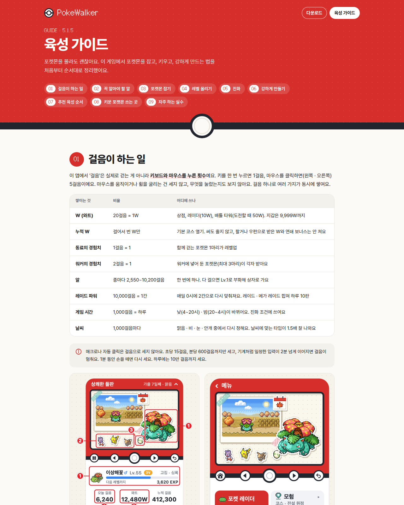
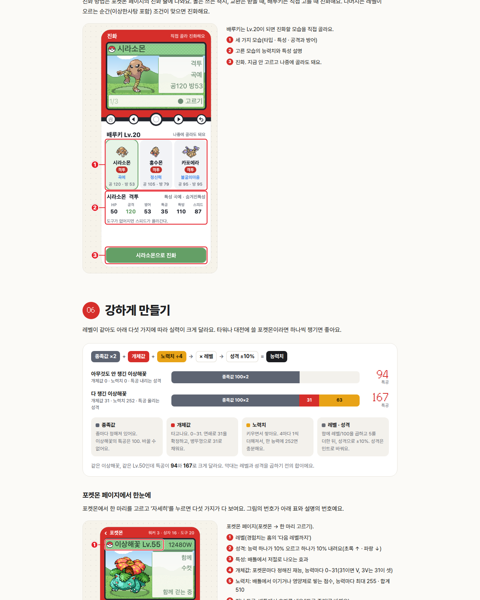
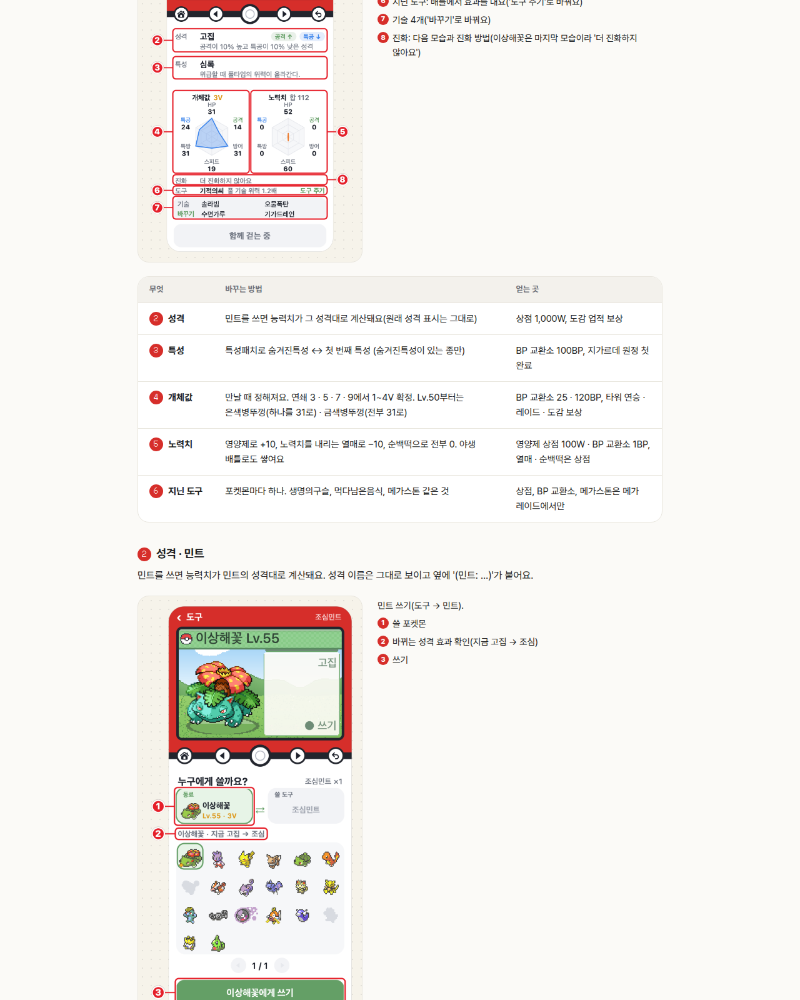

# 공개 사이트 육성 가이드 (/guide) 미리보기

사용자 원문: "이거 아에 우리 공개된 사이트 페이지에 메뉴하나 넣어서 추가하는게 어떨까? 참고 이미지도 같이 넣는게 좋을것같아 특히 6번 강하게 만들기는 포켓몬 게임 모르는사람은 아에 모르는 부분이잖아"

- 코드는 main의 3bfa13d에 있어요. 서버를 로컬(임시 서버, 다른 포트)에서 띄워 캡처했어요.
- 그림은 main 724f587의 `docs/guide/img/` 26장이에요.
- 라이브는 아직 그대로예요. 사용자 OK 뒤에 설치하고, 그림을 싣고, 재시작해요.

## 볼 것

| 파일 | 내용 |
|---|---|
| `home-pc-top.png` · `home-phone-top.png` | 다운로드 페이지 맨 위: 오른쪽에 '육성 가이드' 링크. 폰에서는 다른 페이지 링크 하나만 보여요 |
| `guide-pc-01.png` ~ `guide-pc-12.png` | 가이드 PC 폭(1280) 전체, 위에서부터 |
| `guide-phone-01.png` ~ `guide-phone-18.png` | 가이드 폰 폭(390, 2x) 전체, 위에서부터 |
| `guide-pc-dark-06.png` | 다크 모드: 06 강하게 만들기 |

## 페이지

- 주소는 `/guide`예요. 다운로드 페이지와 같은 빨간 띠, 다크 띠, 몬스터볼 버튼과 폰트를 써요.
- 목차는 맨 위에 01~09 칩으로 있어요(`#basics` `#words` `#catch` `#level` `#evolve` `#strong` `#routine` `#play` `#mistakes`). 오른쪽 아래에는 '목차' 버튼이 늘 떠 있어요.
- 다운로드 페이지와 함께 비밀번호 없이 열리고, 검색 엔진은 막혀 있어요(`noindex, nofollow`, robots.txt).
- 폰에서는 표가 줄마다 카드가 되고, 전후 그림은 위아래로 놓여요. PC에서는 전후 그림이 나란히 놓이고, 그림이 하나뿐이면 캡션이 옆에 와요.
- 캡션의 ①, ②… 는 줄마다 빨간 점 번호로 나와요. 그림 속 번호와 같은 모양이에요.

## 06 강하게 만들기

- 개념 그림(HTML/CSS): 능력치 = (종족값 ×2 + 개체값 + 노력치 ÷4) × 레벨/100 + 5, 그다음 성격 ±10%. 코드의 식(`Mon.swift`)과 같아요.
  - 그림들과 같은 이상해꽃으로 보여 줘요: 특공 종족값 100, Lv.50에서 아무것도 안 챙기면 94, 다 챙기면(31 · 252 · 올리는 성격) 167이에요.
- 포켓몬 페이지 그림(①~⑧)을 먼저 보여 주고, 표의 번호를 그림 번호에 맞췄어요: ② 성격, ③ 특성, ④ 개체값, ⑤ 노력치, ⑥ 지닌 도구. 그래서 표의 순서가 글과 조금 달라요.
- 표 아래에는 번호마다 소제목과 그림이 있어요.
  - ② 성격 · 민트: 민트 쓰기, 민트 전후
  - ③ 특성 · 특성패치
  - ④ 개체값 · 병뚜껑: 은색병뚜껑 쓰기, 은색 전후, 금색 전후
  - ⑤ 노력치 · 영양제: 영양제 6종, 리보플라빈 전후
  - ⑥ 지닌 도구 · 메가진화: 도구 주기, 메가진화
  - ⑦ 기술 고르기: 기술 바꾸기

## 글: 코드와 달라서 고친 곳

회사가 쓴 5.1.5 글을 코드(앱 · 공용 · 서버)와 하나씩 대조했어요.

- **01 걸음**
  - 키는 1걸음, 마우스 클릭(왼쪽 · 오른쪽)은 5걸음이에요. 마우스 이동과 휠은 세지 않아요.
  - 알은 종마다 2,550~10,200걸음이에요(대부분 5,100). 한 번에 하나만 갖고, 부화하면 상자로 가요.
  - 레이드 파워는 0시에 2칸으로 **다시 맞춰져요**(남은 칸은 사라져요). 하루 10판은 레이드와 메가 레이드를 합친 수예요.
  - 누적 W는 기본 코스를 열 때 써요. 써도 줄지 않고, 연쇄 보너스는 들어가지 않아요.
  - 날씨는 1,000걸음마다 다시 정해요(그대로일 수도 있어요). 맞는 타입은 1.5배 잘 나와요.
  - 게임 시간의 낮은 4~20시, 밤은 20~4시예요.
  - 매크로 막기에 두 가지를 더했어요: 1분 동안 손을 떼면 다시 세고, 하루 10만 걸음까지만 세요.
- **02 꼭 알아야 할 말**
  - 성격 25가지 중 5가지는 아무것도 바꾸지 않아요.
  - 노력치는 한 능력에 255까지 쌓여요. 4마다 1씩 반영되니 252면 충분해요.
  - 뮤츠는 상점이 아니라 BP 교환소에서 얻어요.
- **03 포켓몬 잡기**
  - 연쇄가 이어질 확률은 한 번마다 8%씩 줄어요. 도망치거나 지면 끊겨요.
  - 이로치 확률은 이어질수록 조금씩 올라 10부터 1/10이에요.
  - 손님 포켓몬이 먼저 10%로 나오고, 나머지 90%를 A · B · C가 20 · 30 · 50%로 나눠요.
  - 전설 코스는 2%에서 시작해 연쇄 1번마다 1%씩 올라 최대 6%예요.
  - 레이드 볼은 하나마다 처음 잡는 종이면 30%, 이미 있는 종이면 10%예요.
  - 교환 메뉴는 '친구 ▸ 교환'이에요.
  - 전설 원정은 지금 지가르데 하나예요(5 · 6세대 전설 원정은 5.2 · 5.3).
- **04 레벨 올리기**
  - 워커로 보내기는 포켓몬 페이지(자세히)에 있고, 워커가 3마리보다 적을 때만 보여요.
  - 야생 배틀은 잡아도 경험치를 받아요.
  - 이상한사탕은 타워 연승과 레이드 주간 보상으로도 와요.
  - 맡긴 포켓몬은 우편함으로 돌아와요.
  - 새로 넣은 알림: Lv.100인 포켓몬에게 간 경험치는 쓰이지 않아요.
- **05 진화**
  - 변함없는돌은 진화의 돌은 막지 못해요.
  - 낮 · 밤은 걸음으로 흐르는 게임 시간이에요.
  - 리피아는 숲 코스 어디서나 돼요.
  - 교환 진화는 받는 쪽에서 일어나요.
  - 이상한사탕으로 레벨이 올라도 진화해요. 돌은 쓰는 즉시, 교환은 받을 때, 배루키는 고를 때 진화해요.
- **06 강하게 만들기**
  - 개체값은 잡을 때가 아니라 만날 때 정해져요. 병뚜껑은 타워 연승 외에 레이드 · 도감 보상으로도 와요.
  - 영양제는 상점 100W 또는 BP 교환소 1BP예요. 노력치 열매와 순백떡은 상점에서만 팔아요.
  - 특성패치는 숨겨진특성이 있는 종에게만 써요. 얻는 곳은 지가르데 원정을 처음 끝냈을 때예요.
  - 메가스톤은 메가 레이드에서만 나오고, 상점이나 BP 교환소에서는 팔지 않아요.
  - 기술 바꾸기는 지금 레벨까지 배우는 기술을 공짜로 다시 골라요.
- **07 · 08 쓰는 곳**
  - 연쇄 7 이상은 3V, 9 이상은 4V예요.
  - 타워 참가비는 도전할 때 한 번 내요. 1마리 제한에는 환상 포켓몬도 들어가요. 연승 보상은 처음 이룰 때만 와요. 7승째마다 보너스 BP가 붙어요.
  - 레이드에는 내 포켓몬 1~3마리가 지금 레벨 그대로 나가요.
  - 메가스톤이 나올 확률은 ★1 3%부터 ★4 10%, ★5 20%예요. 20승 확정은 그 스톤이 없을 때 쌓여요.
  - 대전은 대전 파티(3~6마리)를 등록해 두고, 상대를 본 뒤 3마리를 골라요.
  - 전설 원정은 지금 지가르데예요: 칼로스 코스에서 3,000걸음마다 셀 1개, 50개면 끝나요. 처음 끝내면 특성패치도 받아요.
  - 도감 업적 보상에 BP도 있어요. '약 2배'는 레이더 · 알에서 이로치를 한 번 더 굴린다는 뜻이에요.
- **09 자주 하는 실수**
  - 빨간 점은 21시부터, 남은 칸이 있을 때 켜져요.
  - 이브이는 레벨과 상관없이 숲 코스나 얼음 산길에서 레벨업하면 리피아 · 글레이시아가 돼요.
  - 님피아는 친밀도가 찼고 페어리 기술이면 무엇이든 알 때 다른 진화보다 먼저예요.
  - 새로 넣은 알림: 레이드 볼 화면을 나가면 남은 볼이 사라져요.
  - 세이브는 서버에 있다는 말을 더했어요.

## 그림 싣는 법(설치 때)

- `server/guide.sh`가 main의 `docs/guide/`를 `/var/lib/pokewalker/guide`에 싣어요. PNG는 무손실 WebP로 바꿔요(26장, 3.9MB → 1.5MB).
- 그림만 바꿀 때는 `guide.sh`만 다시 돌리면 돼요. 재시작은 필요 없어요.
- 그림 이름 규칙(Mac 세션)
  - 앞 두 자리가 섹션이에요.
  - 섹션 안에서는 이름순으로 놓여요.
  - `-before` · `-after`는 한 그림으로 나란히 놓여요.
  - 캡션은 README에서 파일 이름이 든 줄의 나머지 글이에요.
- 그림의 자리는 글에서 정해요(`<!--figs 06-05 …-->`). 자리를 정하지 않은 새 그림은 그 섹션 끝에 놓여요.
